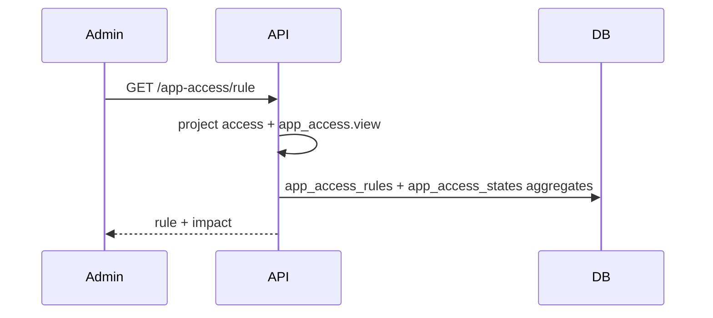
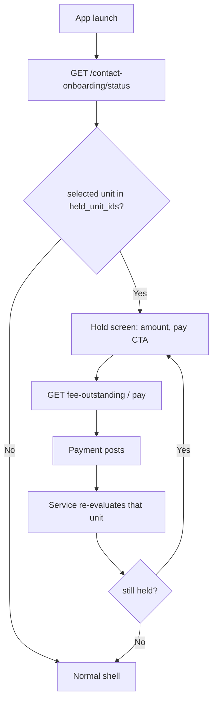

# App Access Control Flow — Context & Change Guide

> **Status: Not yet implemented (ADR + flow spec).** No migrations, API, or UI in this phase.
> This document is the build contract for **Administration → App Access Control** only.
> Users, Teams, Roles, Sessions, Audit Logs, and Tasks in the same prototype HTML are out of
> scope — they already have their own docs, or they need a separate ADR.
>
> Schema and architecture rationale: [ADR 0019](./adr/0019-app-access-control.md).
> Outstanding and due dates come from [0017-fee-configuration-flow.md](./0017-fee-configuration-flow.md).

- **Service:** `ats-home-craft-python-service` → `apps/user_service`
- **Staff API prefix:** `/v1/projects/{project_id}/app-access`
- **Resident API:** `GET /v1/units/{unit_id}/app-access`, plus `app_access` on
  `GET /v1/contact-onboarding/status`
- **DB schema:** `ats-home-craft-supabase` (migrations not yet added — names proposed in
  [ADR 0019](./adr/0019-app-access-control.md))

______________________________________________________________________

## 1. What this flow does

A society can drop the **resident** app to a hold when a unit's fee invoices stay unpaid past
their due date — by how much is owed, how long it has been owed, or both.

Staff set **one rule per project**. The rule does not generate invoices and does not change a
due date. It reads open `fee_invoices` and decides whether that unit is held. Staff can
**Release** or **Block now** one unit without changing the rule.

Residents on a held unit see a hold screen, can still open invoices and pay, and cannot use
the rest of the app **for that unit**.

**Staff never take this hold.** Staff APIs, the staff admin app, and gate/security tools do
not call the hold helper, do not return `unit_held`, and do not show the hold screen — even
when the same person also lives in the held unit.

### Who uses it

| Role            | What they do here                                            | How often                           |
| --------------- | ------------------------------------------------------------ | ----------------------------------- |
| Community Admin | Turns the rule on, sets thresholds, releases a hardship case | A few times a year, plus exceptions |
| Accountant      | Same, plus watches the Customers tab after a billing run     | Monthly                             |
| FM Head         | Reads the list                                               | Rarely                              |
| Resident        | Sees the hold screen, pays, gets access back                 | Only when held                      |

### Two tabs

| Tab           | Holds                                                                                            |
| ------------- | ------------------------------------------------------------------------------------------------ |
| **Rule**      | Master switch, amount condition, days-overdue condition, AND/OR when both are on, Save / Discard |
| **Customers** | One row per unit: outstanding, invoice age, days past due, access state, blocked-on, override    |

The prototype's **payment window** (step 1) is **not on this screen**. Due dates already live
on each fee head (`due_within_days`) and are snapshotted onto the invoice. Helper copy on the
Rule tab points admins to Finance → Fee Configuration.

______________________________________________________________________

## 2. Vocabulary

Use these words in code, API, and UI.

| Term               | Means                                                                                  |
| ------------------ | -------------------------------------------------------------------------------------- |
| **Rule**           | The one `app_access_rules` row for the project                                         |
| **Unit**           | The billed party. Prototype "customer" maps here                                       |
| **Outstanding**    | Same figure as `GET /v1/units/{unit_id}/fee-outstanding` → `total_outstanding`         |
| **Days past due**  | `max(days_overdue(due_date))` across open invoices. The due date itself is not overdue |
| **Hold / blocked** | Resident writes for that unit return 403. App shows the hold screen                    |
| **Watchlist**      | Past due, but under the amount / days thresholds. App is not held                      |
| **Override**       | Per-unit `hold` or `release` that skips the rule until staff delete it                 |
| **Back to rule**   | Deletes the override. Next evaluation uses the rule alone                              |
| **Blocked on**     | Stamp of the first transition into `blocked`. Does not move on later runs              |

Do not say "customer", "lock the login", or "turn off portal_access". Those mean other things
in this codebase.

______________________________________________________________________

## 3. Product rules

| Rule                                                | Enforcement                                                                                                                                           |
| --------------------------------------------------- | ----------------------------------------------------------------------------------------------------------------------------------------------------- |
| **One rule per project**                            | Unique `project_id`. First `PUT` inserts. No delete route                                                                                             |
| **No rule row means off**                           | Missing row evaluates as `enabled: false`. Nobody is held                                                                                             |
| **Enabled requires at least one condition**         | `PUT` with `enabled: true` and both conditions off → **422**                                                                                          |
| **Amount is at or above the threshold**             | `outstanding >= amount_threshold`                                                                                                                     |
| **Days is strictly more than the threshold**        | `days_past_due > days_threshold` (same as the prototype)                                                                                              |
| **AND/OR only when both conditions are on**         | `match_mode` is stored always; evaluation ignores it until both flags are true                                                                        |
| **Zero outstanding is always clear**                | Paying to ₹0 deletes a hand override too, then status is `clear`                                                                                      |
| **Not yet due is never blocked by the rule**        | Manual **Block now** can still hold a unit with an open bill                                                                                          |
| **Hand hold on a zero-outstanding unit is refused** | Prototype: "nothing to hold". **422** `app_access.errors.nothing_to_hold`                                                                             |
| **The bill is the unit's**                          | State and overrides key by `unit_id`, not `contact_id`                                                                                                |
| **Hold is per unit**                                | A contact with another clear unit keeps full access on that unit                                                                                      |
| **Who is held**                                     | Resident app only: active Owner, Tenant, or Family on that unit with `portal_access`                                                                  |
| **Staff never get hold checks**                     | No `ensure_resident_unit_not_held` on staff routes or staff JWT. Dual-role users are held only in the resident app. Gate `project_members` are staff. |
| **Fee invoices only**                               | Facility-booking wallets are out                                                                                                                      |
| **Due dates are not rewritten**                     | No payment-window field on the rule                                                                                                                   |
| **Days, not hours**                                 | `days_threshold` is 1–365                                                                                                                             |
| **`blocked_on` is sticky**                          | First transition into `blocked` stamps it. Later runs keep it. Leaving `blocked` clears it                                                            |
| **Payment re-evaluates immediately**                | A payment that drops the unit under the rule lifts the hold in that request                                                                           |
| **Partial payment can lift a rule hold**            | If outstanding falls below the amount threshold (and days alone is off, or AND is not met)                                                            |
| **Concurrent save loses cleanly**                   | `version` mismatch → **409**                                                                                                                          |
| **Save confirm names the impact**                   | `PUT` response (and `GET` rule) include live impact counts so the client can confirm before apply                                                     |

______________________________________________________________________

## 4. Screen → capability map

Nav: **Administration → App Access Control**. Breadcrumb `Administration / App Access Control`.

### 4.1 Rule tab

| Screen element                                    | Capability                                                         |
| ------------------------------------------------- | ------------------------------------------------------------------ |
| Master switch "Block the app on overdue payments" | `enabled` on `GET` / `PUT .../rule`                                |
| Step 1 payment window                             | **Not built.** Static note + link to Fee Configuration             |
| By amount checkbox + ₹ input                      | `by_amount`, `amount_threshold`                                    |
| By days overdue checkbox + days input             | `by_days`, `days_threshold`                                        |
| "Both are true" / "Either is true"                | `match_mode` `all` / `any`. Shown only when both conditions are on |
| Save rule                                         | `PUT .../rule` with `version`. Client confirms using `impact`      |
| Discard changes                                   | Client-only. Re-`GET` the rule                                     |
| Unsaved changes                                   | Client dirty flag. Not a server concept                            |

Save confirm copy (client, from `impact.blocked`):

> The rule runs against every unit the next time dues are evaluated.
> **{n} unit(s)** would drop to read-only immediately.

Server applies on `PUT`, then re-evaluates. There is no separate "preview" route. The client
may `GET` the rule (which includes `impact` computed from the **saved** rule) while editing
locally, and compute a local preview the same way if it wants a live count before save. The
authoritative count after save is the `PUT` response `impact`.

### 4.2 Customers tab

| Screen element    | Capability                                            |
| ----------------- | ----------------------------------------------------- |
| Impact chips      | `impact` on `GET .../rule` or on the units list       |
| Table             | `GET .../units`                                       |
| Release           | `POST .../units/{unit_id}/override` `{kind: release}` |
| Block now         | `POST .../units/{unit_id}/override` `{kind: hold}`    |
| Back to rule      | `DELETE .../units/{unit_id}/override`                 |
| Empty outstanding | Row shows "nothing to hold"; override buttons hidden  |

Columns:

| Column         | Source                                            |
| -------------- | ------------------------------------------------- |
| Customer       | Primary resident name + `units.code` (unit label) |
| Outstanding    | `outstanding_amount`                              |
| Invoice raised | `oldest_invoice_date` → "{n} days ago"            |
| Days past due  | `days_past_due`, or "not yet"                     |
| App access     | `status` badge                                    |
| Blocked on     | `blocked_on` + `blocked_by` (`rule` / `hand`)     |
| Override       | Buttons from `override_kind` and `status`         |

Badge labels (client copy, keyed by `status`):

| `status`   | Label       | Colour |
| ---------- | ----------- | ------ |
| `blocked`  | Blocked     | red    |
| `notdue`   | Not yet due | grey   |
| `watch`    | Watchlist   | slate  |
| `released` | Released    | blue   |
| `clear`    | Clear       | green  |

______________________________________________________________________

## 5. What this reads (no new columns on those tables)

| Need                  | Source                                                                                           |
| --------------------- | ------------------------------------------------------------------------------------------------ |
| Open invoices         | `fee_invoices` where `status IN ('issued', 'partial')`                                           |
| Payments and credit   | `fee_invoice_payments` + unapplied unit credit — same as `FeeBillingService.outstanding_summary` |
| Due date              | `fee_invoices.due_date`                                                                          |
| Invoice raised        | `fee_invoices.invoice_date`                                                                      |
| Unit code             | `units.code` / `units.unit_label`                                                                |
| Resident display name | Active Owner, else Tenant, else first Family on the unit (`contacts` via `contact_roles`)        |
| Who may use the app   | `contact_units` active + `contact_roles` in Owner / Tenant / Family + `contacts.portal_access`   |
| Days overdue helper   | `fee_late_fee.days_overdue(due_date, as_of)` — already shipped                                   |

Do **not** read `finance_settings`, facility-booking invoices, or `contacts.portal_access` as
a write target.

______________________________________________________________________

## 6. Evaluation

`as_of` is the Asia/Kolkata calendar day, same clock as fee billing.

For one unit:

```
open          = unpaid issued/partial invoices
outstanding   = fee outstanding total (decimal string on the API)
days_past_due = max days_overdue(due_date, as_of) across open invoices
                (0 if none are past due)
oldest_raised = min(invoice_date) across open, else null
```

Then [ADR 0019 §4](./adr/0019-app-access-control.md):

1. Override `hold` → `blocked` ("Blocked by hand"), even if still inside the due date.
1. Override `release` → `released`.
1. `outstanding <= 0` → `clear`. (A hold override on a now-paid unit: still `blocked` until
   staff Back-to-rule **or** we auto-clear holds on zero outstanding.)

**Auto-clear of a hand hold:** when outstanding reaches 0, delete the override and set
`clear`. The resident who paid should not stay held because someone clicked Block now last
week. Staff can Block now again if a new bill appears.

1. No open invoice past due → `notdue` when outstanding > 0.
1. Rule off or no condition on → `clear`.
1. Else apply amount / days / match_mode → `blocked` or `watch`.

### 6.1 Worked checks (as_of = 2026-10-28)

Rule: `enabled`, `by_amount` ₹25,000, `by_days` 15, `match_mode = all`.

| Unit | Outstanding | Due date   | Days past due | Override | Status   | Why                               |
| ---- | ----------- | ---------- | ------------- | -------- | -------- | --------------------------------- |
| A    | 48,200      | 2026-10-02 | 26            | —        | blocked  | Amount and days both hit          |
| B    | 12,800      | 2026-09-22 | 36            | —        | watch    | Days hit, amount below            |
| C    | 92,400      | 2026-10-19 | 9             | —        | watch    | Amount hit, days not more than 15 |
| D    | 27,600      | 2026-11-03 | 0             | —        | notdue   | Open bill, not past due           |
| E    | 0           | —          | —             | —        | clear    | Nothing outstanding               |
| F    | 7,400       | 2026-09-02 | 56            | release  | released | Rule skipped                      |
| G    | 18,900      | 2026-10-20 | 8             | hold     | blocked  | Blocked by hand                   |
| H    | 1,150,000   | 2026-10-16 | 12            | —        | watch    | Amount hit, days 12 is not > 15   |

Flip `match_mode` to `any` and unit B becomes `blocked` (days alone). Unit C becomes
`blocked` (amount alone). That is the prototype's "aggressive" warning.

### 6.2 `blocked_on`

| Event                                      | Stamp                                    |
| ------------------------------------------ | ---------------------------------------- |
| Status first becomes `blocked` by the rule | `evaluated_at`, `blocked_by = rule`      |
| Manual hold                                | now, `blocked_by = hand`                 |
| Status leaves `blocked`                    | both fields null                         |
| Still `blocked` on a later run             | keep the original stamp and `blocked_by` |

______________________________________________________________________

## 7. Architecture (layers)

```
HTTP → API router → AppAccessService → AppAccessRepository → Postgres
         │                │
         │                ├── FeeBillingService.outstanding_summary (read)
         │                └── fee_late_fee.days_overdue
         │
         ├── ensure_staff_project_access(project_id)     staff (RBAC only — no hold check)
         └── ensure_resident_unit_not_held(unit_id)      resident writes only
```

Same 3-layer FastAPI pattern. Staff reads use `db_conn`. Staff writes and evaluate use `db_uow`.
Mutations use `@audit_api_call`.

Evaluate is also called in-process from `FeeBillingService` after an invoice is issued and
after a payment is posted. The daily fee-billing job calls `evaluate_project(project_id)` at
the end of the run. Do not add a second Dkron job in this phase.

### File map (to create)

| Concern                 | File                                                                                           |
| ----------------------- | ---------------------------------------------------------------------------------------------- |
| Staff routes            | `app/api/app_access.py`                                                                        |
| Resident route          | `GET /v1/units/{unit_id}/app-access` in `app/api/app_access.py` or units router                |
| Route registration      | `app/api/routes.py`                                                                            |
| Rules, evaluate, impact | `app/services/app_access_service.py`                                                           |
| SQL                     | `app/db/repositories/app_access_repository.py`                                                 |
| Schemas                 | `app/schemas/app_access.py`                                                                    |
| Enums                   | `app/schemas/enums/app_access.py`                                                              |
| Resident hold helper    | `app/utils/app_access_guard.py` → `ensure_resident_unit_not_held`                              |
| Status payload          | extend `OnboardingStatusResponse` with optional `app_access`                                   |
| i18n                    | `app/locales/en.json` under `app_access.*`                                                     |
| Tests                   | `tests/unit/test_app_access_service.py`, `tests/integration/app_access/test_app_access_api.py` |

### Permissions

New codes, seeded on default project roles. Org ceiling must include the same codes.

| Code                  | Use                                      |
| --------------------- | ---------------------------------------- |
| `app_access.view`     | `GET` rule, `GET` units, resident status |
| `app_access.edit`     | `PUT` rule                               |
| `app_access.override` | `POST` / `DELETE` override               |

Seed matrix: [ADR 0019 §7](./adr/0019-app-access-control.md).

Resident routes do not use these codes. They use the contact's unit link.

______________________________________________________________________

## 8. Data model

Full columns and checks: [ADR 0019 § Schema](./adr/0019-app-access-control.md#schema-proposed).

| Table                  | Purpose                                                          |
| ---------------------- | ---------------------------------------------------------------- |
| `app_access_rules`     | One row per project. Switch, conditions, `match_mode`, `version` |
| `app_access_overrides` | Zero or one row per unit. `hold` or `release`                    |
| `app_access_states`    | Last evaluation per unit. Staff table and resident hold payload  |

A project starts with **no** rule row. Units start with **no** state row. `GET` units still
returns every unit that has an open fee invoice **or** a current override **or** a state row,
so a just-paid unit that went `clear` remains visible until the next daily prune. Phase 1
does not prune `clear` rows with no override.

______________________________________________________________________

## 9. API catalog

Staff JWT, org context, `ensure_staff_project_access`, and the permission in §7.

Base: `/v1/projects/{project_id}/app-access`

| Method | Path                        | Permission | Purpose                                       |
| ------ | --------------------------- | ---------- | --------------------------------------------- |
| GET    | `/rule`                     | view       | Saved rule + impact counts                    |
| PUT    | `/rule`                     | edit       | Create-or-replace rule, then evaluate project |
| GET    | `/units`                    | view       | Customers tab                                 |
| POST   | `/units/{unit_id}/override` | override   | Block now or Release                          |
| DELETE | `/units/{unit_id}/override` | override   | Back to rule                                  |

Resident (contact JWT, active link to the unit):

| Method | Path                             | Purpose                      |
| ------ | -------------------------------- | ---------------------------- |
| GET    | `/v1/units/{unit_id}/app-access` | Hold payload for one unit    |
| GET    | `/v1/contact-onboarding/status`  | Adds `app_access` (see §9.5) |

No staff `DELETE` of the rule. No resident write of the rule.

### 9.1 Rule

`GET` when no row exists:

```json
{
  "exists": false,
  "enabled": false,
  "by_amount": false,
  "amount_threshold": "0.00",
  "by_days": false,
  "days_threshold": 15,
  "match_mode": "all",
  "version": 0,
  "impact": {
    "blocked": 0,
    "watch": 0,
    "notdue": 0,
    "released": 0,
    "clear": 0,
    "blocked_amount": "0.00",
    "overdue_amount": "0.00"
  }
}
```

`PUT` body (all fields required except the server sets `impact` and increments `version`):

```json
{
  "enabled": true,
  "by_amount": true,
  "amount_threshold": "25000.00",
  "by_days": true,
  "days_threshold": 15,
  "match_mode": "all",
  "version": 1
}
```

`version: 0` on first insert. After insert, `version` is 1. Subsequent saves send the current
version. Miss → **409** `app_access.errors.version_conflict`.

`PUT` response is the saved document plus fresh `impact` plus `exists: true`.

Impact:

| Field            | Meaning                                              |
| ---------------- | ---------------------------------------------------- |
| `blocked`        | Units with status `blocked`                          |
| `watch`          | Status `watch`                                       |
| `notdue`         | Status `notdue`                                      |
| `released`       | Status `released`                                    |
| `clear`          | Status `clear` among rows in the units list          |
| `blocked_amount` | Sum of outstanding on `blocked` units                |
| `overdue_amount` | Sum of outstanding on units with `days_past_due > 0` |

Money is a decimal string. Counts are integers.

### 9.2 Units list

`GET /units?q=&status=&page=1&page_size=25`

| Query                | Rule                                                          |
| -------------------- | ------------------------------------------------------------- |
| `q`                  | Optional. Matches unit code / label and primary resident name |
| `status`             | Optional. One of the five statuses, or omit for all           |
| `page` / `page_size` | `list_response`. Default page size 25, max 100                |

Each item:

```json
{
  "unit_id": "unit-uuid",
  "unit_code": "B-1104",
  "display_name": "Rohit Malhotra",
  "outstanding_amount": "48200.00",
  "oldest_invoice_date": "2026-09-17",
  "days_past_due": 26,
  "status": "blocked",
  "blocked_on": "2026-10-27T09:12:00+05:30",
  "blocked_by": "rule",
  "reason": "₹48,200 is at or above ₹25,000 and 26 days past due is more than 15",
  "override_kind": null,
  "evaluated_at": "2026-10-28T00:05:00+05:30"
}
```

| Field           | Notes                                                          |
| --------------- | -------------------------------------------------------------- |
| `display_name`  | Primary occupant. `"—"` if the unit has no Owner/Tenant/Family |
| `days_past_due` | Integer. `0` when not overdue. `null` when outstanding is 0    |
| `blocked_on`    | ISO timestamptz. `null` unless `status = blocked`              |
| `blocked_by`    | `rule` or `hand`. `null` unless blocked                        |
| `override_kind` | `hold`, `release`, or `null`                                   |
| `reason`        | Staff-visible why string from evaluate                         |

Override buttons (client):

| `override_kind` | `status`    | Outstanding | Actions                                         |
| --------------- | ----------- | ----------- | ----------------------------------------------- |
| `null`          | `blocked`   | > 0         | Release                                         |
| `null`          | not blocked | > 0         | Block now                                       |
| `release`       | any         | > 0         | Back to rule                                    |
| `hold`          | `blocked`   | > 0         | Back to rule (and Release is already the state) |
| any             | any         | = 0         | none — "nothing to hold"                        |

A `hold` row also shows **Back to rule** so staff can undo the hand block. It does not show
Release (already blocked).

### 9.3 Override

`POST /units/{unit_id}/override`

```json
{ "kind": "hold" }
```

or `{ "kind": "release" }`. Replaces an existing override on that unit. Response is the units
list item after re-evaluate.

`DELETE` returns the same item shape after the override row is gone and the unit is
re-evaluated.

Unknown unit in the project → **404**. Unit in another project → **404** (do not leak).

### 9.4 Resident unit payload

`GET /v1/units/{unit_id}/app-access`

```json
{
  "unit_id": "unit-uuid",
  "status": "blocked",
  "held": true,
  "outstanding_amount": "48200.00",
  "days_past_due": 26,
  "blocked_on": "2026-10-27T09:12:00+05:30",
  "reason_key": "app_access.hold.rule"
}
```

`held` is `status === "blocked"`. The app keys copy off `reason_key`:

| `reason_key`             | When                |
| ------------------------ | ------------------- |
| `app_access.hold.rule`   | Blocked by the rule |
| `app_access.hold.manual` | Blocked by hand     |
| `app_access.hold.none`   | Not held            |

Residents do not receive `match_mode`, thresholds, or `override_kind`.

No state row and not held → `{ "held": false, "status": "clear", "reason_key": "app_access.hold.none", ...nulls }`.

### 9.5 Onboarding status addition

`GET /v1/contact-onboarding/status` grows an `app_access` object. Existing fields do not
change.

```json
"app_access": {
  "any_held": true,
  "held_unit_ids": ["unit-uuid"],
  "units": [
    {
      "unit_id": "unit-uuid",
      "unit_code": "B-1104",
      "status": "blocked",
      "held": true,
      "outstanding_amount": "48200.00",
      "days_past_due": 26,
      "reason_key": "app_access.hold.rule"
    }
  ]
}
```

`units` lists every **active** unit for the contact. The app shows the hold shell when the
currently selected / default unit is in `held_unit_ids`. Switching to a clear unit dismisses
the shell.

### 9.6 Hold error on resident writes only

`ensure_resident_unit_not_held(unit_id)` runs **only** on resident routes, after the usual
unit-access check.

**Do not call it for staff.** Staff routers (`/v1/projects/...`, `/v1/marketplace/admin`,
staff fee invoices, staff passes, gate verify, notices admin, …) skip this helper. A staff
JWT must not receive `app_access.errors.unit_held`. Staff `GET /v1/users/profile` does not
include `app_access`. If the same person is `organization_members` and a resident contact,
only the resident app session is held.

**403** body (resident):

```json
{
  "status": "error",
  "statusCode": 403,
  "code": "app_access.errors.unit_held",
  "message": "This unit is on hold until outstanding dues are paid.",
  "data": {
    "unit_id": "unit-uuid",
    "outstanding_amount": "48200.00",
    "reason_key": "app_access.hold.rule"
  }
}
```

Resident allow-list (do **not** call the helper):

- Auth, refresh, logout
- `GET /v1/contact-onboarding/status`, resident profile reads, `POST /default-unit`
- `GET /v1/units/{unit_id}/app-access`
- `GET /v1/units/{unit_id}/fee-outstanding`, `GET /v1/units/{unit_id}/fee-invoices`, invoice detail
- Resident payment once that route exists

Wire the helper on **resident** writes (and any resident GET that starts a booking / pass /
listing) in: visitor passes, walk-in, tenant requests, notices (likes), community events
(book), daily help, pets, parking/vehicles, marketplace, facility booking.

Staff equivalents of those modules keep working on a held unit. Example: security can still
`POST /v1/passes/verify` for a held flat; an accountant can still `POST .../fee-invoices/.../payments`.

______________________________________________________________________

## 10. Validation

| Field / action                         | Rule                                     | Error key                              |
| -------------------------------------- | ---------------------------------------- | -------------------------------------- |
| `version`                              | Must match. Else **409**                 | `app_access.errors.version_conflict`   |
| `enabled: true`                        | `by_amount` or `by_days`                 | `app_access.errors.condition_required` |
| `amount_threshold`                     | ≥ 0, two decimal places, `numeric(14,2)` | `app_access.errors.invalid_amount`     |
| `days_threshold`                       | Integer 1–365                            | `app_access.errors.invalid_days`       |
| `match_mode`                           | `all` or `any`                           | `app_access.errors.invalid_match_mode` |
| Override `kind`                        | `hold` or `release`                      | `app_access.errors.invalid_override`   |
| Block now / Release when outstanding 0 | **422**                                  | `app_access.errors.nothing_to_hold`    |
| Unit not in project                    | **404**                                  | `app_access.errors.unit_not_found`     |
| Held unit write (resident only)        | **403**. Staff callers never hit this    | `app_access.errors.unit_held`          |

User-facing 409 copy: "Someone else changed this rule. Reload and try again."

______________________________________________________________________

## 11. End-to-end flows

### 11.1 Open the Rule tab



### 11.2 Save the rule

1. Client edits locally. Master off greys step 2. Both conditions on reveals AND/OR.
1. Client confirms with the local or last-known `impact.blocked` count.
1. `PUT` the full document plus `version`.
1. Service rejects enabled-with-no-condition (422) before write.
1. Compare-and-swap `version`. Insert when `version` is 0 and no row exists.
1. `evaluate_project`. Response includes new `version` and fresh `impact`.
1. 409 → reload the rule. The switch does not stick.

### 11.3 Release one unit

1. Customers tab. Row is `blocked`.
1. Confirm: "Give {name} full access back even though ₹{amount} is still outstanding? The rule will stop applying until the override is removed."
1. `POST .../override` `{kind: release}`.
1. Row becomes `released`. Button becomes **Back to rule**.

### 11.4 Resident hits a hold



A write that skipped the status check still gets **403** `unit_held` and the app routes to
the hold screen from `data.reason_key`.

### 11.5 Payment lifts a rule hold

1. Staff or resident posts a payment on an open invoice.
1. `FeeBillingService` records it, then calls `AppAccessService.evaluate_unit(unit_id)`.
1. If outstanding is now 0, any override is deleted and status is `clear`.
1. If outstanding is still > 0, the formula runs again. AND of ₹25,000 and 15 days: paying
   down to ₹20,000 lifts a rule block even if still 26 days past due.

______________________________________________________________________

## 12. When evaluation runs

| Event                        | Scope                                                                |
| ---------------------------- | -------------------------------------------------------------------- |
| `PUT /rule`                  | Every unit with open invoices, an override, or an existing state row |
| Invoice issued or cancelled  | That unit                                                            |
| Payment posted               | That unit                                                            |
| Override set or deleted      | That unit                                                            |
| End of daily fee-billing job | Same set as `PUT /rule`                                              |

Resident `GET` reads `app_access_states`. It does not recompute, except that a missing row
is treated as not held.

If a society has more than a few thousand open-invoice units, `PUT /rule` should queue
evaluate and return **202** with the saved rule (`evaluate_pending: true`). Phase 1 may keep
it synchronous. Open question 4 in the ADR.

______________________________________________________________________

## 13. Cross-cutting conventions

- **Auth:** staff JWT, `organization_id` on every query, `ensure_staff_project_access(project_id)`.
  Staff auth is RBAC only. It does not evaluate app-access state.
- **Responses:** `success_response` for rule, override, and resident payload; `list_response` for units.
- **Writes:** compare-and-swap on `version`.
- **Audit:** `@audit_api_call` on `PUT` rule and override POST/DELETE.
- **Serialization:** UUID as string, money as decimal strings, dates as ISO, timestamptz as ISO-8601.
- **i18n:** validation and hold copy under `app_access.*`. Reason sentences for staff can be
  built in the service (they include rupee figures and day counts).
- **Clock:** Asia/Kolkata date for days past due, same as fee billing.

______________________________________________________________________

## 14. Out of scope

- Prototype step-1 payment window (lives on fee heads)
- Hours-granularity holds
- Facility-booking outstanding in the amount
- Flipping `contacts.portal_access`
- Holding staff, gate security, or any staff JWT (hard rule — not a later add-on)
- Users, Teams, Roles, Sessions, Audit Logs, Tasks, AI employees from the same HTML file
- A new Dkron job (hook the existing fee-billing job)
- Resident push "your app is on hold" (follow-up)

______________________________________________________________________

## 15. Implementation checklist

1. Migrations in [ADR 0019](./adr/0019-app-access-control.md): enums, tables, permission seed.
1. Add `app_access.*` to `libs/shared_utils/common_query.py` and `DEFAULT_PROJECT_ROLE_PERMISSIONS`.
1. Service: evaluate formula + `blocked_on` stamp + impact aggregates.
1. Staff API: rule GET/PUT, units list, override POST/DELETE.
1. Hook `evaluate_unit` from fee invoice issue and payment.
1. Hook `evaluate_project` at the end of the daily fee-billing job.
1. Resident `GET /units/{id}/app-access` and `app_access` on onboarding status.
1. `ensure_resident_unit_not_held` on **resident** write modules listed in §9.6. Assert it is
   absent from staff routers.
1. Unit tests for the worked checks in §6.1, override auto-clear on zero outstanding, version conflict, enabled-without-condition.
1. Integration tests: resident 403 `unit_held` on a held unit; staff 200 on the same unit
   (payment, pass, notice). Dual-role user: staff session succeeds, resident session held.
